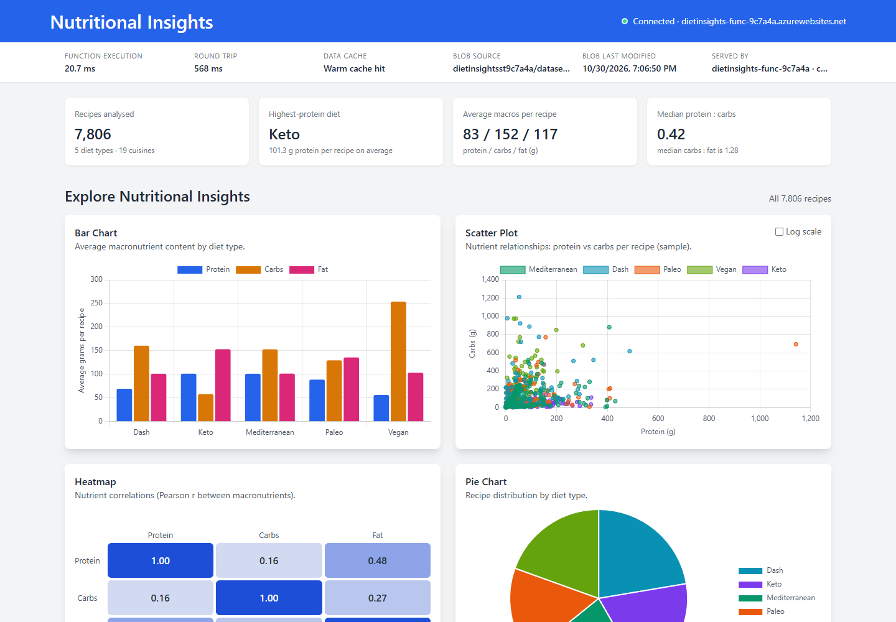

# Nutritional Insights: Cloud Dashboard (Project Phase 2)

An Azure Functions API (Python) reads `All_Diets.csv` from Azure Blob Storage and analyses it with pandas. A dashboard hosted on Azure App Service calls that API and draws the results with Chart.js.



| Deliverable | Where |
|---|---|
| Azure Function URL | https://dietinsights-func-9c7a4a.azurewebsites.net/api (try [`/insights`](https://dietinsights-func-9c7a4a.azurewebsites.net/api/insights) or [`/health`](https://dietinsights-func-9c7a4a.azurewebsites.net/api/health)) |
| Dashboard (App Service) | https://dietinsights-web-9c7a4a.azurewebsites.net |
| GitHub repository | https://github.com/pawsp7/nutritional-insights-dashboard |
| Documentation PDF | [docs/Phase2_Documentation.pdf](docs/Phase2_Documentation.pdf) |

The deploy script also writes these URLs to `infra/deployment-outputs.json`.

## Architecture

```
Browser ──① page──▶ Azure App Service web app, Free F1 (frontend/)
   │
   └──② fetch /api/* (CORS)──▶ Azure Function App (backend/, Python 3.13, Flex Consumption)
                                   │  ③ download blob (connection string from app settings)
                                   ▼
                              Storage account ── private container "datasets" ── All_Diets.csv
   ◀──④ JSON {data, meta: executionTimeMs, cache, blob, region}──┘
```

All resources live in the resource group `diet-analysis-rg`. Application Insights collects function logs.

## API

| Endpoint | Parameters | Returns |
|---|---|---|
| `GET /api/insights` | `diet`, `refresh=true` | summary, average macros by diet, distribution, correlation matrix, scatter sample, top protein recipes, common cuisines |
| `GET /api/recipes` | `diet`, `search`, `sort` (protein, carbs, fat, name), `order`, `page`, `pageSize` (≤100) | paginated recipes with protein:carbs and carbs:fat ratios |
| `GET /api/clusters` | `diet`, `k` (2–6) | k-means clusters by macro profile |
| `GET /api/health` | none | settings check and blob reachability |

Every response also includes `meta`: function execution time, warm-cache hit or Blob read, which blob was used and when it was last modified, and the app and region that served it.

## Deploy to Azure

Requirements: [Azure CLI](https://learn.microsoft.com/cli/azure/install-azure-cli). Azure Cloud Shell (PowerShell) already has it.

```powershell
az login
powershell -ExecutionPolicy Bypass -File infra/deploy.ps1
```

The script is idempotent. It creates the resource group, storage account and private container, uploads the CSV, creates the Function App (with Application Insights), sets the `DIETS_*` app settings, zip-deploys the backend with a remote build, creates a Free (F1) App Service web app for the dashboard, sets CORS, writes `frontend/js/config.js` and deploys the dashboard. It then smoke-tests the API and writes the URLs to `infra/deployment-outputs.json`.

Why App Service rather than Static Web Apps: Azure for Students subscriptions only allow deployments to five regions (Canada Central, France Central, Norway East, Belgium Central, Mexico Central), and Static Web Apps can't be created in any of them. On a subscription without that policy, `-FrontendHost staticwebapp` deploys to a Free Static Web App instead (this also needs Node.js).

Options: `-Location`, `-FrontendHost appservice|staticwebapp`, `-StaticWebAppLocation`, `-Plan consumption` (if Flex Consumption is unavailable), `-AllowLocalDev` (lets `localhost:4280` call the cloud API), `-SkipFrontend`.

To remove everything:

```powershell
powershell -ExecutionPolicy Bypass -File infra/teardown.ps1
```

## Run locally

```powershell
# 1. Blob Storage emulator (Azurite), as in Phase 1
npx azurite-blob --location .azurite

# 2. Backend
cd backend
py -3.13 -m venv .venv                     # Python 3.13+ (azure-functions 2.x needs it)
.venv\Scripts\pip install -r requirements-dev.txt
copy local.settings.example.json local.settings.json
.venv\Scripts\python upload_dataset.py      # puts data/All_Diets.csv into Azurite
func start                                   # Azure Functions Core Tools
# (no Core Tools? .venv\Scripts\python dev_server.py serves the same handlers on :7071)

# 3. Dashboard
cd ..\frontend
python -m http.server 4280                   # http://localhost:4280
```

After a cloud deploy, `config.js` points at Azure. To use the local API again, open `http://localhost:4280/?api=http://localhost:7071/api`.

## Tests

```powershell
cd backend
.venv\Scripts\python -m pytest -q
```

There are 20 tests covering cleaning rules, aggregates, JSON safety, pagination and search, k-means, and the HTTP handlers (cache, 400/404/503). They run with a fake blob source. GitHub Actions runs them on every push (`.github/workflows/ci.yml`). To redeploy after a change, re-run `infra/deploy.ps1`.

## Configuration

| App setting | Default | Purpose |
|---|---|---|
| `DIETS_STORAGE_CONNECTION` | falls back to `AzureWebJobsStorage` | storage account holding the dataset |
| `DIETS_CONTAINER` | `datasets` | blob container |
| `DIETS_BLOB` | `All_Diets.csv` | blob name |
| `DIETS_CACHE_SECONDS` | `300` | how long a warm instance reuses the parsed data |

## Layout

```
backend/     function_app.py, analysis.py, data_source.py, host.json, requirements.txt, tests/
frontend/    index.html, css/app.css, js/app.js, js/config.js, web.config (App Service), staticwebapp.config.json
data/        All_Diets.csv
infra/       deploy.ps1, teardown.ps1
docs/        Phase2_Documentation.pdf (+ .html source), screenshots/, tools/capture.mjs
```
